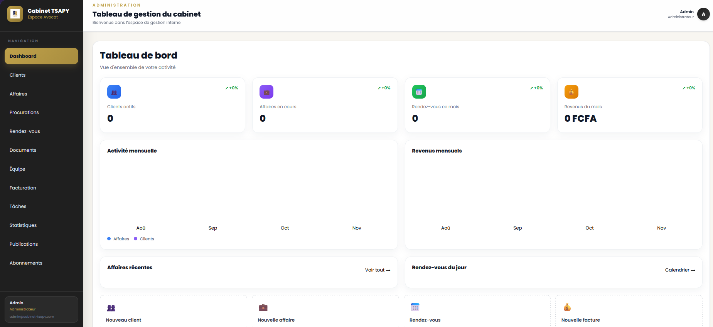

# ⚖️ GECADAV — Cabinet Tsapy

### Plateforme web full-stack pour la digitalisation d'un cabinet d'avocats

**Angular 20 | TypeScript | Tailwind CSS | Java 21 | Spring Boot 3 | PostgreSQL**

🌐 **Site web :** https://cabinet-tsapy.com/  
👩🏽‍💻 **Développeuse :** Simone Tsapy  
📍 **Client :** Cabinet Tsapy — Bafoussam, Cameroun

---

## 📌 Présentation du projet

**GECADAV (Gestion d'un Cabinet d'Avocats)** est une plateforme web full-stack conçue et développée pour le Cabinet Tsapy, un cabinet d'avocats basé à Bafoussam, au Cameroun.

Ce projet répond à un double objectif :

1. **Renforcer la présence numérique du cabinet** à travers un site vitrine moderne, responsive et bilingue.
2. **Digitaliser la gestion interne du cabinet** grâce à une application métier centralisant les clients, les affaires juridiques, les rendez-vous, les documents, la facturation et le suivi des activités.

La plateforme associe une interface publique destinée aux visiteurs et un espace d'administration permettant aux collaborateurs du cabinet de gérer leurs opérations quotidiennes.

Il s'agit d'un projet réalisé pour un besoin réel, de l'analyse fonctionnelle au développement et au déploiement.

---

## 🎯 Objectifs

Le projet vise à :

- Moderniser l'image et la présence numérique du cabinet.
- Améliorer son accessibilité auprès des clients locaux et internationaux.
- Faciliter les prises de contact et les demandes de renseignements.
- Centraliser les informations relatives aux clients et aux affaires juridiques.
- Simplifier l'organisation des rendez-vous, tâches et documents.
- Faciliter le suivi de la facturation et des activités.
- Mettre à disposition des indicateurs pour le pilotage du cabinet.

---

## 🚀 Fonctionnalités

La plateforme comprend deux espaces complémentaires.

### 🌐 1. Site vitrine public

Le site vitrine permet de présenter le cabinet et de faciliter sa visibilité auprès de nouveaux clients.

**Fonctionnalités principales :**

- **Accueil :** présentation du cabinet et de ses services.
- **Présentation du cabinet :** histoire, valeurs et vision.
- **Équipe :** présentation des avocats et de leurs parcours.
- **Domaines d'expertise :** consultation des prestations juridiques proposées.
- **Contact :** informations et moyens de contacter le cabinet.
- **Multilingue :** interface disponible en français et en anglais.
- **Responsive design :** adaptation aux ordinateurs, tablettes et smartphones.

🔗 **Découvrir le site :** https://cabinet-tsapy.com/

### 🖥️ 2. Application web de gestion interne

En complément du site vitrine, GECADAV intègre un espace d'administration destiné à digitaliser et centraliser les activités du cabinet.

Les modules sont développés, fonctionnels et connectés à la base de données PostgreSQL via le backend Spring Boot.

#### Gestion des clients

- Enregistrement des clients.
- Consultation et modification des informations.
- Organisation et suivi des données clients.

#### Gestion des affaires juridiques

- Création et gestion des affaires.
- Consultation et mise à jour des dossiers.
- Suivi des affaires en cours.

#### Gestion des procurations

- Enregistrement et gestion des procurations.
- Centralisation des informations associées.

#### Gestion des rendez-vous

- Planification et gestion des rendez-vous.
- Consultation des rendez-vous enregistrés.
- Suivi de l'activité liée aux rendez-vous.

#### Gestion documentaire

- Centralisation des documents du cabinet.
- Organisation et consultation des informations documentaires.

#### Gestion de l'équipe

- Gestion des membres de l'équipe.
- Consultation et mise à jour des informations associées.

#### Facturation

- Gestion des informations de facturation.
- Suivi des opérations financières.
- Consultation des données liées aux revenus du cabinet.

#### Gestion des tâches

- Organisation des tâches internes.
- Suivi des activités à réaliser.

#### Tableau de bord et statistiques

Le tableau de bord fournit une vue synthétique de l'activité du cabinet à travers plusieurs indicateurs :

- Nombre de clients actifs.
- Nombre d'affaires en cours.
- Nombre de rendez-vous du mois.
- Revenus mensuels en FCFA.
- Visualisation de l'activité mensuelle.
- Visualisation des revenus mensuels.

**État actuel :** l'application de gestion est fonctionnelle, mais le cabinet n'a pas encore commencé à l'utiliser régulièrement pour ses opérations quotidiennes. Les indicateurs affichent donc actuellement des valeurs nulles, faute de données métier saisies en production.

---

## 🛠️ Stack technique

| Catégorie | Technologies |
|---|---|
| Frontend | Angular 20, TypeScript |
| Interface utilisateur | HTML5, CSS3, Tailwind CSS 4 |
| Backend | Java 21, Spring Boot 3 |
| API | REST |
| Base de données | PostgreSQL |
| Authentification | Gestion de l'accès à l'espace d'administration |
| Versionnement | Git, GitHub |

### Architecture de l'application

La plateforme repose sur une architecture séparant le frontend, le backend et la persistance des données.

```text
                    UTILISATEURS
                         |
              +----------+----------+
              |                     |
              v                     v
       SITE VITRINE          ESPACE ADMINISTRATION
              |                     |
              +----------+----------+
                         |
                         v
                  ANGULAR 20
                 (TypeScript)
                         |
                         | Requêtes HTTP
                         v
                   API REST
                 SPRING BOOT
                   (Java 21)
                         |
                         v
                   POSTGRESQL
                  Base de données
```

### Frontend — Angular

Le frontend assure :

- La construction des interfaces utilisateur.
- La navigation entre les différentes pages.
- La gestion des formulaires et des interactions.
- L'affichage des données métier.
- La communication avec les services backend.
- La présentation des indicateurs du tableau de bord.

### Backend — Spring Boot

Le backend assure :

- L'exposition des API REST.
- Le traitement des opérations métier.
- La communication avec la base de données.
- La gestion de l'authentification et des accès.
- La transmission des données au frontend Angular.

### Base de données — PostgreSQL

PostgreSQL assure la persistance des informations nécessaires au fonctionnement de l'application de gestion.

Elle permet notamment de stocker et de retrouver les données relatives aux clients, aux affaires et aux autres modules métier.

---

## 🌍 Impact réel du projet et visibilité internationale

Le site web du Cabinet Tsapy est accessible en production et contribue au développement de la présence numérique du cabinet au Cameroun et à l'international.

Les données de **Google Search Console**, sur une période de trois mois, montrent que le site génère des clics depuis plusieurs pays.

| Pays | Clics | Impressions |
|---|---:|---:|
| 🇨🇲 Cameroun | 16 | 475 |
| 🇩🇪 Allemagne | 5 | 18 |
| 🇫🇷 France | 4 | 41 |
| 🇨🇦 Canada | 2 | 12 |
| 🇬🇧 Royaume-Uni | 2 | 7 |
| 🇲🇦 Maroc | 1 | 1 |
| 🇬🇷 Grèce | 1 | 1 |

*Données Google Search Console — période de trois mois, pays visibles dans l'extrait.*

### Résultats obtenus

- Visibilité du site au-delà du Cameroun.
- Trafic organique provenant de plusieurs pays.
- Présence du cabinet dans les résultats de recherche Google à l'international.
- Facilitation des prises de contact avec des clients potentiels.

En complément des données de référencement, le cabinet a également reçu des prises de contact provenant de plusieurs pays, notamment du Cameroun, de France, d'Allemagne, du Togo et du Canada.

Ces résultats illustrent l'impact concret du projet sur la visibilité numérique du cabinet et sa capacité à toucher un public international.

### Valeur apportée

**Visibilité internationale :** le cabinet bénéficie d'une présence numérique accessible au-delà du Cameroun.

**Accessibilité :** les visiteurs peuvent consulter les domaines d'expertise et les coordonnées du cabinet à distance.

**Digitalisation :** une application de gestion interne est disponible pour centraliser les informations et les processus métier.

**Pilotage :** le tableau de bord permettra au cabinet de suivre ses activités à mesure que les données seront saisies.

Ce projet illustre la contribution concrète du développement logiciel à la modernisation d'une organisation et à l'élargissement de sa portée géographique.

---

## 👩🏽‍💻 Mon rôle et mes contributions

J'ai assuré la conception et le développement de la plateforme GECADAV, comprenant le site vitrine public et l'application de gestion interne.

Mes principales contributions :

- Recueil et analyse des besoins du cabinet.
- Définition des fonctionnalités et de l'organisation de l'application.
- Conception des interfaces utilisateur.
- Développement du frontend avec Angular et TypeScript.
- Intégration des interfaces responsive avec Tailwind CSS.
- Développement du backend avec Java et Spring Boot.
- Conception et intégration de la base de données PostgreSQL.
- Mise en place des échanges entre le frontend et l'API REST.
- Développement des modules de gestion métier.
- Création du tableau de bord et des indicateurs.
- Mise en ligne du site et suivi de ses évolutions.

Ce projet m'a permis de mettre en pratique une démarche de développement complète, depuis l'identification d'un besoin métier jusqu'à la réalisation d'une solution fonctionnelle.

---

## 📸 Aperçu de l'application

### Site vitrine

Le site public permet aux visiteurs de découvrir le cabinet, ses avocats et ses domaines d'expertise.

🌐 https://cabinet-tsapy.com/

### Tableau de bord administratif

L'espace de gestion comprend un tableau de bord affichant des indicateurs d'activité et donnant accès aux différents modules internes.

### 🖥️ Tableau de bord administratif

L'espace de gestion comprend un tableau de bord affichant les principaux indicateurs d'activité et donnant accès aux différents modules internes.



## 💻 Installation et lancement

Cette section décrit le lancement local du frontend Angular.

### Prérequis

- Node.js compatible avec Angular 20
- npm
- Git

### 1. Cloner le dépôt

```bash
git clone https://github.com/simone170402/gecadav.git
cd gecadav
```

### 2. Installer les dépendances

```bash
npm install
```

### 3. Démarrer le frontend

```bash
npm start
```

L'application sera accessible à l'adresse :

http://localhost:4200/

**Remarque :** les fonctionnalités de gestion nécessitent une API backend opérationnelle et une configuration adaptée. Le frontend seul ne permet pas nécessairement d'exécuter l'ensemble de la plateforme en local.

### 4. Générer une version de production

```bash
npm run build
```

---

## 📊 État du projet

| Composant | État |
|---|---|
| Site vitrine | Développé et en production |
| Interface bilingue | Disponible |
| Application d'administration | Développée et fonctionnelle |
| API Spring Boot | Fonctionnelle |
| Base PostgreSQL | Connectée |
| Modules de gestion | Fonctionnels |
| Tableau de bord | Fonctionnel |
| Utilisation quotidienne par le cabinet | Pas encore commencée |

Le projet est opérationnel sur le plan technique. L'adoption de l'application de gestion par le cabinet constitue la prochaine étape métier.

---

## 🔮 Perspectives d'évolution

- Accompagner la prise en main de l'application par les collaborateurs.
- Enrichir les fonctionnalités selon les retours des utilisateurs.
- Améliorer progressivement l'expérience utilisateur.
- Poursuivre les optimisations de performance et d'accessibilité.
- Faire évoluer les tableaux de bord en fonction des besoins de suivi.

---

## 👩🏽‍🎓 À propos

**Simone Tsapy**

Ingénieure en informatique diplômée de Polytech Nancy, orientée développement front-end et full-stack.

Je conçois et développe des applications web répondant à des besoins métier concrets, en intervenant sur différentes étapes du cycle de développement : analyse, conception, implémentation, intégration et déploiement.

**Technologies principales :** Angular, TypeScript, Java, Spring Boot, PHP, SQL et PostgreSQL.

🔗 **GitHub :** https://github.com/simone170402

---

*GECADAV — Un projet de digitalisation développé pour le Cabinet Tsapy.*
